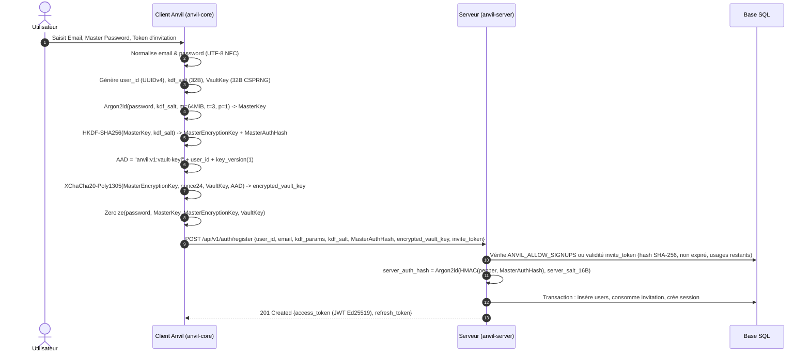
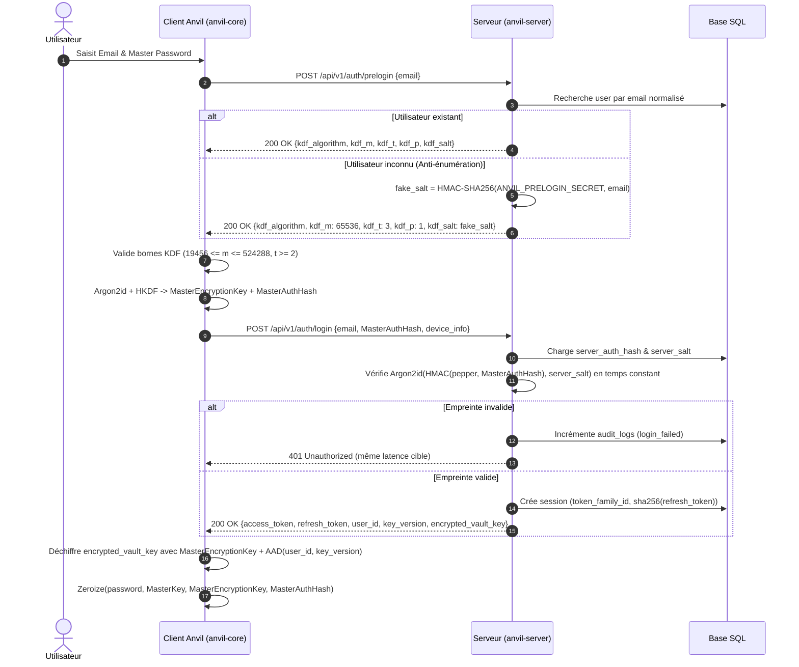
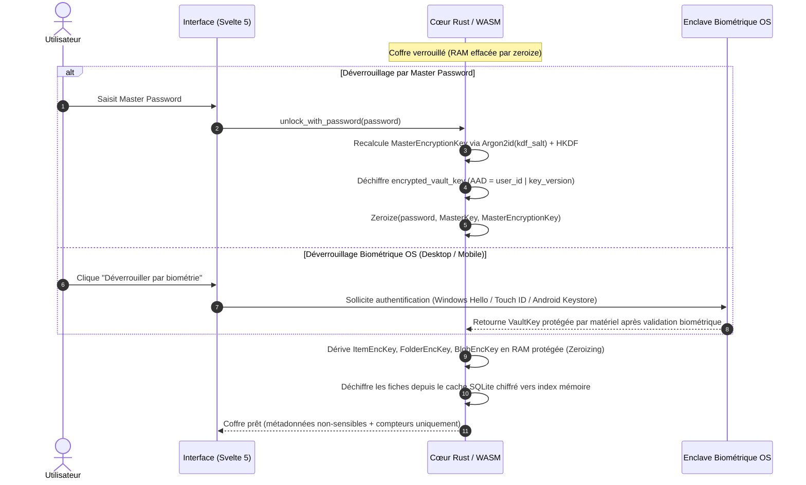
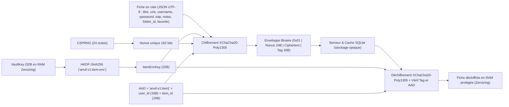
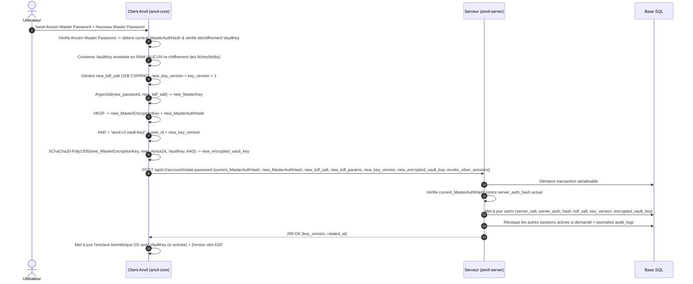

# Architecture Technique & Cryptographique — **Anvil**

> **Version** : Architecture Technique & Cryptographique — Référence v1  
> **Objet** : Gestionnaire de mots de passe et d'authentification 2FA (TOTP) auto-hébergeable (*self-hosted*), multi-utilisateurs et strictement **Zero-Knowledge**, centré sur l'écosystème **Rust**.

---

## Table des matières

1. [Identité & Direction UI/UX (« Forge Moderne / Acier Sombre »)](#1-identite--direction-uiux--forge-moderne--acier-sombre-)
2. [Stack Technique & Justification des Choix](#2-stack-technique--justification-des-choix)
3. [Schéma Cryptographique Détaillé (Zero-Knowledge)](#3-schema-cryptographique-detaille-zero-knowledge)
4. [Schéma de Base de Données SQL & Spécification API REST](#4-schema-de-base-de-donnees-sql--specification-api-rest)
5. [Modèle de Fiche & Architecture Import/Export Multi-Gestionnaires](#5-modele-de-fiche--architecture-importexport-multi-gestionnaires)
6. [Arborescence Complète du Cargo Workspace & Monorepo](#6-arborescence-complete-du-cargo-workspace--monorepo)

---

## 1. Identité & Direction UI/UX (« Forge Moderne / Acier Sombre »)

### 1.1 Philosophie visuelle & Ergonomie

Anvil adopte une esthétique **« Forge Moderne / Acier Sombre »** conçue pour la vitesse d'exécution, la lisibilité prolongée sans fatigue oculaire et la clarté immédiate des états de sécurité :

- **Mode sombre natif par défaut** : surfaces stratifiées en obsidienne et anthracite profond, séparées par des bordures nettes de `1px` plutôt que des ombres lourdes.
- **Accents signifiants** :
  - **Cuivre / Braise (`#E07A2F`)** : action principale, focus clavier, alerte visuelle forge et hommage direct à Rust.
  - **Acier bleuté (`#5B8DEF`)** : état de synchronisation, liens secondaires et distinction visuelle des chiffres dans les mots de passe.
- **Ergonomie « Clavier-First »** : chaque flux majeur (recherche `Ctrl+K`, copie mot de passe/TOTP, génération, verrouillage d'urgence `Ctrl+L`) est accessible sans quitter le clavier, avec retour visuel instantané (toast discret avec barre de décompte de nettoyage du presse-papiers).

### 1.2 Palette Hexadécimale & Tokens CSS

| Catégorie | Token CSS | Valeur | Rôle dans l'interface |
| :--- | :--- | :--- | :--- |
| **Surfaces** | `--bg-void` | `#0B0C0F` | Barre de titre custom, barre latérale gauche, fond le plus profond |
| | `--bg-surface` | `#12141A` | Liste des fiches, panneau de détail, fond principal |
| | `--bg-elevated` | `#191C24` | Cartes de champs, modales, menus contextuels, popover TOTP |
| | `--bg-hover` | `#20242F` | Survol de ligne, boutons secondaires |
| | `--bg-active` | `#272C3A` | Fiche sélectionnée, onglet actif |
| **Bordures** | `--border-subtle` | `#222632` | Séparateurs de colonnes et grilles internes (`1px solid`) |
| | `--border-default` | `#2E3444` | Champs de saisie, badges, contours de cartes |
| | `--border-focus` | `#E07A2F` | Anneau de focus clavier et champ actif |
| **Textes** | `--text-primary` | `#F1F3F7` | Titres de services, identifiants principaux |
| | `--text-secondary` | `#9BA3B5` | Libellés de champs, sous-titres, URLs |
| | `--text-muted` | `#636B7E` | Raccourcis clavier, horodatages, placeholders |
| **Accents** | `--accent-forge` | `#E07A2F` | CTA primaires, bordure de focus, badge de sélection forge |
| | `--accent-forge-hover` | `#F28C3E` | État hover des actions principales |
| | `--accent-forge-muted` | `rgba(224, 122, 47, 0.14)` | Fond de badge actif / surbrillance discrète |
| | `--accent-steel` | `#5B8DEF` | Indicateur de synchronisation active, liens et chips |
| | `--accent-steel-muted` | `rgba(91, 141, 239, 0.14)` | Fond de bannière informative / Sync |
| **Statuts** | `--status-secure` | `#2FB379` | Coffre déverrouillé, entropie forte, synchronisation OK |
| | `--status-warning` | `#E5A93C` | TOTP < 5s restantes, mot de passe faible ou réutilisé |
| | `--status-danger` | `#E04F5F` | Bouton fermer (hover), suppression, erreur d'intégrité/phishing |

#### Coloration syntaxique des mots de passe (anti-ambiguïté `0/O`, `1/l/I`)

Lorsqu'un mot de passe est affiché en clair ou généré, chaque classe de caractère reçoit une couleur distincte afin d'éviter toute confusion visuelle lors d'une saisie manuelle sur un autre appareil :

| Type de caractère | Token | Couleur | Exemple |
| :--- | :--- | :--- | :--- |
| Lettres (`a-z`, `A-Z`) | `--pw-alpha` | `#F1F3F7` | `Kj` |
| Chiffres (`0-9`) | `--pw-digit` | `#5B8DEF` | `09` |
| Symboles (`!@#...`) | `--pw-symbol` | `#E07A2F` | `$%` |

### 1.3 Typographie (100 % embarquée localement, zéro appel CDN)

Pour garantir l'absence totale de fuite réseau ou de télémétrie de polices, les fichiers `.woff2` sont embarqués dans le bundle local :

- **Police UI Sans** : `'Inter', 'Segoe UI Variable', -apple-system, BlinkMacSystemFont, system-ui, sans-serif`
- **Police Monospace** : `'JetBrains Mono', 'Cascadia Code', ui-monospace, monospace`
  - Directives CSS obligatoires sur les mots de passe et codes OTP :
    - `font-feature-settings: "zero" 1;` (zéro barré pour le distinguer de `O`)
    - `font-variant-numeric: tabular-nums;` (largeur fixe pour stabiliser le compte à rebours TOTP de `30s`)

| Niveau | Taille | Graisse | Usage |
| :--- | :--- | :--- | :--- |
| Micro / Raccourcis | `11px` | `500` | Kbd badges (`Ctrl+K`), compteurs de dossiers |
| Métadonnées | `12px` | `400` / `500` | URLs, dates de mise à jour, labels de champs |
| Corps Desktop dense | `13.5px` | `400` / `500` | Listes d'entrées, formulaires, barres de menu |
| Titre de fiche | `16px` | `600` | En-tête de fiche sélectionnée |
| En-têtes de modales | `20px` | `600` | Titres de dialogues (Import, Export, Paramètres) |
| Code TOTP actif | `24px` | `700` | `123 456` avec `letter-spacing: 0.12em` |

### 1.4 Raccourcis Clavier Standards

| Raccourci (Windows / Linux) | Raccourci (macOS) | Action |
| :--- | :--- | :--- |
| `Ctrl+K` | `Cmd+K` | Focus immédiat sur la barre de recherche globale (ou palette rapide) |
| `Ctrl+N` | `Cmd+N` | Créer une nouvelle fiche |
| `Ctrl+Shift+C` | `Cmd+Shift+C` | Copier le mot de passe de la fiche active (auto-clear 30s) |
| `Ctrl+Shift+U` | `Cmd+Shift+U` | Copier le username ou l'email de la fiche active |
| `Ctrl+Shift+T` | `Cmd+Shift+T` | Copier le code TOTP courant (auto-clear 30s) |
| `Ctrl+L` | `Cmd+L` | Verrouiller immédiatement le coffre et déclencher `zeroize` en RAM |
| `Ctrl+Shift+G` | `Cmd+Shift+G` | Ouvrir le générateur de mots de passe / passphrases |
| `↑` / `↓` puis `Enter` | `↑` / `↓` puis `Return` | Naviguer dans la liste des fiches et ouvrir/copier |
| `Esc` | `Esc` | Effacer la recherche / fermer la modale / masquer le mot de passe |
| `Ctrl+Alt+A` *(configurable)* | `Cmd+Option+A` *(configurable)* | Raccourci global OS : afficher/masquer Anvil Desktop depuis n'importe quelle application |

### 1.5 Logo SVG Minimaliste (« Bouclier-Enclume Géométrique »)

#### A. Logo Principal (`64x64`) — Splash, À propos, Page de connexion, Onboarding

Bouclier octogonal sombre à crête rouge carmin intégrant une enclume d'acier brossé surmontée d'une table de frappe rouge forge / braise et d'une étincelle incandescente :

```xml
<svg xmlns="http://www.w3.org/2000/svg" viewBox="0 0 64 64" width="64" height="64" fill="none" role="img" aria-label="Anvil Logo">
  <defs>
    <linearGradient id="anvil-shield-bg" x1="12" y1="6" x2="52" y2="58" gradientUnits="userSpaceOnUse">
      <stop offset="0%" stop-color="#191C24"/>
      <stop offset="100%" stop-color="#0E1015"/>
    </linearGradient>
    <linearGradient id="anvil-forge-ember" x1="13.5" y1="22.5" x2="48" y2="26" gradientUnits="userSpaceOnUse">
      <stop offset="0%" stop-color="#B91C2E"/>
      <stop offset="55%" stop-color="#E63946"/>
      <stop offset="100%" stop-color="#F26A3D"/>
    </linearGradient>
    <linearGradient id="anvil-steel-body" x1="20" y1="25" x2="44" y2="46" gradientUnits="userSpaceOnUse">
      <stop offset="0%" stop-color="#F1F3F7"/>
      <stop offset="100%" stop-color="#B5BECB"/>
    </linearGradient>
  </defs>

  <!-- Bouclier octogonal sombre -->
  <path d="M22 6H42L54 16V35L32 58L10 35V16L22 6Z" fill="url(#anvil-shield-bg)" stroke="#2E3444" stroke-width="2" stroke-linejoin="round"/>
  <path d="M23 9.5H41L50.5 17.5V33.8L32 53.5L13.5 33.8V17.5L23 9.5Z" stroke="#222632" stroke-width="1"/>

  <!-- Crête supérieure rouge carmin -->
  <path d="M22 6H42" stroke="#D63242" stroke-width="2.2" stroke-linecap="round"/>
  <path d="M23.5 9.5H40.5" stroke="#E63946" stroke-opacity="0.55" stroke-width="1.2" stroke-linecap="round"/>

  <!-- Étincelle rouge incandescent -->
  <path d="M32 12.5L35.6 16.8L32 20L28.4 16.8L32 12.5Z" fill="#E63946"/>
  <path d="M32 14.4L33.7 16.7L32 18.4L30.3 16.7L32 14.4Z" fill="#FF7A59"/>

  <!-- Enclume géométrique : corps en acier & reflet de braise -->
  <path d="M14 25.5H47.5V27.6H41.5L37.5 31V38.2L43.5 43V46H20.5V43L26.5 38.2V31L21.5 27.8L14 25.5Z" fill="url(#anvil-steel-body)"/>
  <path d="M20.5 44.8H43.5V46.2H20.5Z" fill="#D63242" fill-opacity="0.85"/>

  <!-- Table de frappe incandescente (rouge forge -> braise) -->
  <path d="M13.5 22.5H48V26H14.5L13.5 22.5Z" fill="url(#anvil-forge-ember)"/>
</svg>
```

#### B. Icône Monochrome Compacte (`24x24`) — Barre de titre, System Tray & Extension Navigateur

```xml
<svg xmlns="http://www.w3.org/2000/svg" viewBox="0 0 24 24" width="24" height="24" fill="currentColor" role="img" aria-label="Anvil Icon">
  <path fill-rule="evenodd" clip-rule="evenodd" d="M8.2 2.5H15.8L20.5 6.4V13.4L12 21.8L3.5 13.4V6.4L8.2 2.5ZM5.5 8.8L18.5 8.8V10.6H16L14.3 12.1V15L16.5 16.8V18H7.5V16.8L9.7 15V12.1L8 10.6L5.5 9.8V8.8Z"/>
</svg>
```

### 1.6 Maquette ASCII & Spécification de la Barre de Titre Custom Windows (`decorations: false`)

La barre blanche native Windows est totalement supprimée (`decorations: false`). Le chrome de fenêtre fusionne dans un bandeau de **`40px` de hauteur fixe** (`#0B0C0F` lorsque la fenêtre a le focus, `#0F1116` avec opacité des icônes à `65%` lorsqu'elle est en arrière-plan).

```text
+---------------------------------------------------------------------------------------------------+
| [Logo] Anvil  ● Synced  |  <drag>  |  [ 🔍 Rechercher un compte, URL, email...   Ctrl+K ]  | <drag> | [↻] [🔒] | ─ | □ | ✕ |
+-------------------------+----------+-------------------------------------------------------+--------+----------+---+---+---+
| COFFRE                  | COMPTE (142)                     | GitHub — Travail                                    [★] [✎] |
|  [*] Tous les comptes   |  +----------------------+        | https://github.com/login                            [↗]     |
|  [★] Favoris        (8) |  | [GH] GitHub - Travail|        |                                                             |
|  [⏱] Récents            |  |      dev@corp.io     |        | Identifiant    dev_anvil                            [📋]    |
|                         |  +----------------------+        | Email          dev@corp.io                          [📋]    |
| DOSSIERS                |    [AW] AWS Console              | Mot de passe   ••••••••••••••                       [👁][📋] |
|  [📁] Personnel    (64) |         ops@corp.io              |                Force: Excellente (78 bits) · 3 modifs       |
|  [📁] Travail      (51) |    [CF] Cloudflare               |                                                             |
|  [📁] Finance      (19) |         admin@domain.net         | Code 2FA (TOTP)                                             |
|                         |    [GM] Proton Mail              |  482 915                              ( 18s )       [📋]    |
| SYSTEME                 |         me@proton.me             |                                                             |
|  [🗑] Corbeille     (3) |                                  | Notes chiffrées                                             |
|  [⚙] Import / Export   |                                  |  Clés de récupération imprimées dans le coffre physique.    |
+-------------------------+----------------------------------+-------------------------------------------------------------+
```

#### Comportement technique de la barre de titre (`apps/desktop`)

1. **Configuration Tauri (`tauri.conf.json`)** :
   - `"decorations": false`, `"shadow": true`, `"transparent": false` (conserve les ombres portées Windows 11 sans artefacts DWM).
   - Bordure externe `1px solid #222632` sur le conteneur racine lorsqu'en mode fenêtré, **supprimée dynamiquement** quand `isMaximized() === true` pour épouser parfaitement l'écran.
2. **Zones interactives vs zones déplaçables** :
   - Le badge logo à gauche et les deux espaces flexibles encadrant la barre de recherche portent `data-tauri-drag-region`.
   - Un double-clic sur `data-tauri-drag-region` bascule l'état maximisé/restauré.
   - La barre de recherche centrale (`max-width: 420px`) et tous les boutons d'action/contrôle (`↻`, `🔒`, `─`, `□`, `✕`) sont exclus du drag region afin de rester cliquables immédiatement.
3. **Gestion des états fenêtre** :
   - Écoute des événements Tauri `onResized` (mise à jour de `isMaximized` pour basculer l'icône `□` ↔ `❐`) et `onFocusChanged` (dimming du chrome à `65%` en arrière-plan).
   - Taille exacte des 3 boutons système à droite : **`46px × 40px`** chacun, alignés sur les conventions Windows 11 (`✕` passe sur fond `#E04F5F` avec icône blanche `#FFFFFF` au survol).
4. **Snap Layouts Windows 11 & Redimensionnement natif (Rust Win32)** :
   - En mode `decorations: false`, WebView2 ne déclenche pas seul les *Snap Layouts* de Windows 11 au survol du bouton Agrandir.
   - `apps/desktop/src-tauri` installe un sous-classement Win32 léger (`SetWindowSubclass` via `windows-sys` / `windows`) interceptant `WM_NCHITTEST` :
     - Retourne `HTMAXBUTTON` lorsque le curseur survole le rectangle calculé du bouton `□`/`❐` (les *Snap Layouts* natifs de Windows 11 apparaissent automatiquement au survol).
     - Retourne `HTLEFT`, `HTRIGHT`, `HTTOP`, `HTBOTTOM` et les 4 coins (`HTTOPLEFT`, etc.) sur une marge invisible de `6px` aux bords de la fenêtre lorsque non maximisée.
5. **Adaptations multi-OS** :
   - **macOS** : `titleBarStyle: "Overlay"`, `hiddenTitle: true`, décalage (`padding-left: 76px`) dans la barre de titre pour laisser les feux tricolores natifs à gauche tout en conservant la barre de recherche centrée.
   - **Linux (Wayland / X11)** : barre de titre CSD custom identique à Windows avec coins arrondis optionnels selon le compositeur.

---

## 2. Stack Technique & Justification des Choix

### 2.1 Choix du Frontend Tauri v2 & Extension : **Svelte 5 (Runes) + TypeScript + Tailwind CSS v4**

| Critère | **Svelte 5 + TypeScript + Tailwind v4 (Retenu)** | React + Tailwind | Full-Rust (Leptos / Dioxus) |
| :--- | :--- | :--- | :--- |
| **Empreinte & Vitesse de démarrage** | Compilé sans Virtual DOM (~25–40 Ko JS). Ouverture instantanée de la popup Extension MV3 (`< 50 ms`) et démarrage WebView2 fluide. | Runtime React + ReactDOM plus lourd (~150+ Ko) + reconciliation Virtual DOM. | Runtime WASM UI supplémentaire (1.5 à 4 Mo) à charger à chaque ouverture de popup MV3. |
| **Partage Desktop / Mobile / Extension** | 100 % des composants (`packages/anvil-ui`) partagés sans coût mémoire additionnel. | Bon partage, mais plus verbeux sur les états réactifs fins (compte à rebours TOTP 30s). | Redondance WASM avec `anvil-wasm` sur l'extension ; écosystème UI Tauri Mobile encore jeune. |
| **Hygiène mémoire Zero-Knowledge** | En Desktop/Mobile, **aucune clé** ne touche le heap JS (`anvil-core` garde les secrets en RAM Rust et écrit dans le presse-papiers en Rust). En Extension, `anvil-wasm` garde les clés en mémoire linéaire WASM. | Identique si isolé, mais état React propice aux copies immuables d'objets contenant des secrets. | Tout reste en WASM, mais débogage DOM/Shadow DOM plus complexe pour l'autofill navigateur. |
| **Typage Rust ↔ UI** | Génération automatique des bindings TypeScript via `tauri-specta` (natif) et `tsify-next` / `wasm-bindgen` (WASM). | Idem. | Natif en Rust, mais interop DOM directe requise pour les content scripts MV3. |

**Décision architecturale** : le frontend TypeScript/Svelte 5 agit strictement comme une **couche de présentation éphémère**. Sur Desktop et Mobile, les secrets (Master Password lors du déverrouillage, `VaultKey`, mots de passe déchiffrés) sont transmis aux commandes Tauri puis immédiatement libérés côté UI ; seule la fiche affichée à l'écran existe transitoirement dans le DOM et est purgée dès le verrouillage (`Ctrl+L`, inactivité ou veille OS).

### 2.2 Liste des Crates Rust Retenues & Justifications

#### A. `crates/anvil-core` (Cœur pur Rust, `no_std`-friendly dans l'esprit, compatible Natif + `wasm32-unknown-unknown`)

| Crate | Rôle exact | Justification technique |
| :--- | :--- | :--- |
| `argon2` | Dérivation KDF Argon2id (RFC 9106) | Référence RustCrypto auditée ; supporte Natif et `wasm32` sans dépendance C. |
| `hkdf`, `sha2`, `sha1`, `hmac` | Séparation de domaines HKDF-SHA256 & primitives HMAC | Permet l'implémentation interne auditée de **TOTP (RFC 6238)** / **HOTP (RFC 4226)** sans dépendre d'horloge OS (injection explicite de `unix_timestamp` pour testabilité et compatibilité WASM). |
| `chacha20poly1305` | Chiffrement AEAD principal (`XChaCha20-Poly1305`) | **Nonces de 192 bits (24 octets)** rendant la probabilité de collision aléatoire négligeable même hors-ligne multi-appareils (contrairement à AES-GCM limité à $\approx 2^{32}$ nonces aléatoires de 96 bits), et exécution constant-time performante en WASM sans AES-NI. |
| `aes`, `cbc`, `pbkdf2` | Compatibilité d'import Bitwarden chiffré uniquement | Requis exclusivement pour déchiffrer les sauvegardes **Bitwarden Encrypted JSON** protégées par mot de passe (`encType = 2`, AES-256-CBC + HMAC-SHA256). |
| `zeroize` (`derive`), `secrecy` | Effacement déterministe de la RAM & protection anti-log | Garantit la mise à zéro des clés/secrets à la destruction (`ZeroizeOnDrop`) et empêche toute fuite accidentelle dans `Debug` / `Display` / logs. |
| `subtle` | Comparaisons en temps constant (`ConstantTimeEq`) | Évite les attaques temporelles sur la vérification de MAC/tokens. |
| `rand_core`, `getrandom` | Génération aléatoire cryptographique (CSPRNG) | Délègue au CSPRNG OS en natif et à `crypto.getRandomValues` en WASM. |
| `data-encoding`, `base64`, `url` | Encodage Base32 (TOTP), Base64url, parsing URI `otpauth://` & URLs | Parsing strict des secrets TOTP et normalisation des URLs. |
| `zxcvbn` | Estimateur réaliste d'entropie et temps de cassage | Évalue la robustesse réelle (dictionnaires, motifs clavier, répétitions) en plus de l'entropie combinatoire. |
| `nucleo-matcher` | Recherche floue instantanée côté client | Algorithme de fuzzy-matching haute performance (issu de Helix), pur Rust, compatible WASM. |
| `psl` | Public Suffix List (extraction `eTLD+1`) | Indispensable pour le matching de domaine et la protection anti-phishing stricte (distinguer `app.github.io` de `evil.github.io` ou `co.uk`). |
| `serde`, `serde_json`, `csv`, `quick-xml`, `zip`, `flate2` | Sérialisation & parseurs d'import/export | Couvre JSON Bitwarden, CSV navigateurs/gestionnaires, XML KeePass, archives `.1pux` 1Password et conteneurs `.anvil` compressés/chiffrés. |
| `image` *(feature optionnelle)* | Traitement des logos personnalisés côté client | Redimensionnement max `128×128`, ré-encodage WebP/PNG propre et **suppression totale des métadonnées EXIF** avant chiffrement. |
| `uuid` (`v4`) | Identifiants opaques CSPRNG | UUIDv4 purement aléatoires pour `user_id`, `item_id`, `folder_id`, `blob_id` (aucune fuite de timestamp ou d'ordre de création contrairement à UUIDv7). |
| `chrono`, `thiserror` | Horodatages UTC et gestion d'erreurs typée | Zéro `.unwrap()` / `.expect()` en production. |

#### B. `crates/anvil-wasm`

| Crate | Rôle exact | Justification technique |
| :--- | :--- | :--- |
| `wasm-bindgen`, `js-sys` | Pont Rust ↔ JavaScript (Extension MV3) | Exposition zéro-copie lorsque possible et gestion explicite des tampons typés. |
| `serde-wasm-bindgen`, `tsify-next` | Sérialisation & génération `.d.ts` TypeScript | Contrat TypeScript strict généré directement depuis les structs Rust de `anvil-core`. |
| `getrandom` (`wasm_js`) | Entropie WebCrypto dans le Worker MV3 | Branche `getrandom` sur `self.crypto.getRandomValues`. |

#### C. `crates/anvil-server` (Serveur Self-Hosted)

| Crate | Rôle exact | Justification technique |
| :--- | :--- | :--- |
| `axum`, `tokio` | Serveur HTTP asynchrone haute performance | Typage fort des extracteurs, middlewares Tower natifs, empreinte mémoire minimale. |
| `tower`, `tower-http` | Middlewares HTTP (`cors`, `trace`, `limit`, `set-header`, `compression`, `request-id`) | En-têtes de sécurité (`X-Content-Type-Options`, `CSP`, `Referrer-Policy`), limites strictes de taille de payload et corrélation de requêtes. |
| `sqlx` (`postgres`, `sqlite`, `tls-rustls`, `migrate`) | Persistance relationnelle asynchrone | Architecture via un enum **`DbPool { Postgres(PgPool), Sqlite(SqlitePool) }`** et un trait `VaultRepository` (évite les compromis de `sqlx::Any`, assure des requêtes typées natives, le mode `WAL` + `PRAGMA foreign_keys = ON` sur SQLite et des migrations dédiées `migrations/postgres` & `migrations/sqlite`). |
| `argon2` | Re-hachage serveur du `MasterAuthHash` | Protège les empreintes stockées en base même en cas de compromission SQL, complété par un pepper optionnel `ANVIL_AUTH_PEPPER`. |
| `jsonwebtoken` (`rust_crypto`) | JWT courte durée signés en **`EdDSA` (Ed25519)** | Signatures rapides, compactes et modernes sans dépendance OpenSSL. |
| `tower_governor` | Rate limiting anti brute-force | Limitation par IP/route sur `/auth/*`, avec extraction d'IP client contrôlée uniquement via `ANVIL_TRUSTED_PROXIES`. |
| `clap` (`derive`) | CLI d'administration embarquée dans le binaire | Sous-commandes `serve`, `invite create/list/revoke`, `user list/disable/promote`, `migrate`. |
| `tracing`, `tracing-subscriber`, `anyhow`, `thiserror` | Observabilité structurée JSON/texte & erreurs | Journaux sans aucune donnée sensible ni secret utilisateur. |
| `reqwest` (`rustls-tls`, feature optionnelle) | Proxy favicon SSRF-hardened (opt-in) | Désactivé par défaut (`ANVIL_ENABLE_FAVICON_PROXY=false`) ; bloque les IP privées/loopback/link-local/metadata cloud, résout le DNS avant connexion et borne taille + type MIME. |

#### D. `crates/anvil-client-core`, `apps/desktop` & `apps/mobile` (Tauri v2)

| Crate | Rôle exact | Justification technique |
| :--- | :--- | :--- |
| `tauri` v2, `tauri-specta` | Runtime Desktop/Mobile & IPC typé | Génère les bindings TS des commandes Tauri à la compilation. |
| `sqlx` (`sqlite`, `runtime-tokio`) | Cache hors-ligne local | Stocke **uniquement les enveloppes chiffrées** reçues du serveur et la file d'attente de mutations hors-ligne (jamais de données déchiffrées sur disque). |
| `reqwest` (`rustls-tls`) | Client HTTP/TLS vers `anvil-server` | Pile TLS 100 % Rust (zéro OpenSSL), compatible Desktop et Mobile. |
| `tauri-plugin-global-shortcut`, `single-instance`, `window-state` | Intégration Desktop | Instance unique, mémorisation position/taille fenêtre, raccourci global OS. |
| `tauri-plugin-biometric`, `tauri-plugin-barcode-scanner` | Biométrie & QR Code Mobile | Accès natif à Android BiometricPrompt / iOS LAContext et caméra pour `otpauth://` + onboarding serveur. |
| `arboard` + Win32 native (`windows`) | Presse-papiers sécurisé & intégration Windows | Pose les formats Windows `ExcludeClipboardContentFromMonitorProcessing` et `CanIncludeInClipboardHistory = 0` (exclut de `Win+V` et de la synchro cloud Microsoft), gère `WTSRegisterSessionNotification` (verrouillage automatique sur `Win+L`), Windows Hello et `WM_NCHITTEST` (Snap Layouts). |
| `security-framework` / `oo7` | Stockage enclave OS macOS / Linux | Keychain / Touch ID sur macOS ; Secret Service (`org.freedesktop.secrets`) sur Linux. |

#### E. Outillage Qualité & Sécurité

- `rustfmt` & `clippy` (règles workspace strictes : `unwrap_used = "deny"`, `expect_used = "deny"`, `panic = "deny"` sur les crates de bibliothèque et binaires hors tests).
- `proptest` (tests basés sur les propriétés : roundtrips crypto, invariants d'import/export).
- `cargo-audit` & `cargo-deny` (CVE, licences, contrôle des dépendances transitives) et `cargo-fuzz` (Phase 6 sur les parseurs et décodeurs binaires).

---

## 3. Schéma Cryptographique Détaillé (Zero-Knowledge)

### 3.1 Principes Fondamentaux & Hiérarchie des Clés

Le serveur `anvil-server` ne voit **jamais** le Master Password, la `MasterEncryptionKey`, la `VaultKey` en clair, ni aucune donnée métier (titres, URLs, usernames, mots de passe, secrets TOTP, notes, noms de dossiers ou logos).

```text
Master Password (UTF-8 NFC) + kdf_salt (32B CSPRNG, généré côté client)
   │
   ▼  Argon2id v0x13 (m = 65536 KiB, t = 3, p = 1) → 32 octets
MasterKey
   │
   ▼  PRK = HKDF-SHA256-Extract(salt = kdf_salt, ikm = MasterKey)
   ├──▶ HKDF-Expand(PRK, "anvil:v1:master-encryption-key") ──▶ MasterEncryptionKey (32B — JAMAIS transmise)
   │         │
   │         └──▶ Wrap XChaCha20-Poly1305(VaultKey)
   │              AAD = "anvil:v1:vault-key|" || user_id (16B) || key_version (u32 BE)
   │
   └──▶ HKDF-Expand(PRK, "anvil:v1:master-auth-hash")      ──▶ MasterAuthHash (32B — envoyée sur TLS)
             │
             ▼  Côté Serveur : HMAC-SHA256(ANVIL_AUTH_PEPPER?, MasterAuthHash)
             └──▶ Argon2id(server_salt_16B, m=19456, t=2, p=1) ──▶ server_auth_hash (stocké en DB)

VaultKey (32B CSPRNG, immuable lors d'un changement de Master Password)
   │
   ├──▶ HKDF-Expand(VaultKey, "anvil:v1:item-enc")   ──▶ ItemEncKey   (XChaCha20-Poly1305, AAD = "anvil:v1:item|" || user_id || item_id)
   ├──▶ HKDF-Expand(VaultKey, "anvil:v1:folder-enc") ──▶ FolderEncKey (XChaCha20-Poly1305, AAD = "anvil:v1:folder|" || user_id || folder_id)
   └──▶ HKDF-Expand(VaultKey, "anvil:v1:blob-enc")   ──▶ BlobEncKey   (XChaCha20-Poly1305, AAD = "anvil:v1:blob|" || user_id || item_id || blob_id)
```

#### Justifications cryptographiques critiques

1. **Parité stricte Natif ↔ WASM (`p = 1`)** : Argon2id avec `m = 65536 KiB` (64 MiB), `t = 3`, `p = 1` dépasse les recommandations minimales de l'OWASP (19 MiB `t=2` ou 46 MiB `t=1`) tout en conservant un calcul mono-thread identique et rapide dans les extensions MV3 WASM (qui ne requièrent ainsi pas d'en-têtes `COOP/COEP` / `SharedArrayBuffer`). Les clients valident les paramètres KDF reçus du serveur dans les bornes de sécurité : `19456 <= m <= 524288`, `t >= 2`, `p >= 1`.
2. **Normalisation et sel client aléatoire** : le Master Password est normalisé en **UTF-8 NFC** avant dérivation (cohérence entre claviers Windows/macOS/iOS/Android). Le `kdf_salt` est un aléa CSPRNG de 32 octets (jamais dérivé de l'email, empêchant les tables précalculées même si deux comptes partagent un email sur différentes instances).
3. **Format d'enveloppe binaire auto-descriptif** : chaque champ chiffré (`encrypted_vault_key`, `encrypted_data`, `encrypted_blob`) suit la structure exacte :
   `[ version: 1 octet (0x01) || nonce: 24 octets (CSPRNG) || ciphertext: N octets || tag Poly1305: 16 octets ]`
   Ce format permet d'évoluer proprement vers une version `0x02` (par ex. algorithme post-quantique hybride futur) sans casser les enregistrements existants.
4. **AAD strict anti-substitution (Context Binding)** : chaque texte chiffré lie cryptographiquement son propriétaire (`user_id`), son identifiant (`item_id` / `folder_id` / `blob_id`) et son type d'entité (`anvil:v1:item|`, `anvil:v1:folder|`, `anvil:v1:blob|`). Un serveur malveillant ou compromis qui déplacerait un blob chiffré d'un utilisateur vers un autre ou d'une fiche vers une autre provoquerait immédiatement un échec d'authentification AEAD côté client.
5. **Confidentialité des métadonnées de structure** : `folder_id`, `favorite`, `trashed_at` et `item_version` sont stockés **à l'intérieur** du payload JSON chiffré de la fiche, et non en colonnes SQL en clair. Le serveur ne connaît que `item_id`, `revision` et `deleted` (tombstone de synchronisation).
6. **Anti-énumération sur `/auth/prelogin`** : si l'email demandé n'existe pas, le serveur renvoie tout de même un `kdf_salt` déterministe factice calculé par `HMAC-SHA256(ANVIL_PRELOGIN_SECRET, email_normalise)` et les paramètres KDF par défaut. Un attaquant ne peut donc pas énumérer les adresses inscrites sur l'instance.

### 3.2 Hygiène Mémoire, Presse-Papiers, Biométrie, Sessions & Synchro Hors-Ligne

- **Effacement RAM (`zeroize`)** : `MasterKey`, `MasterEncryptionKey`, `MasterAuthHash`, `VaultKey`, sous-clés HKDF et mots de passe en clair implémentent `ZeroizeOnDrop`. Au verrouillage (`Ctrl+L`, dépassement du délai d'inactivité configurable, mise en veille OS ou `WTSRegisterSessionNotification` sur Windows), le coffre est purgé de la mémoire immédiatement.
- **Nettoyage conditionnel du presse-papiers** : lors de la copie d'un mot de passe ou d'un TOTP, Anvil calcule un `SHA-256` éphémère en RAM et programme un minuteur (défaut `30s`). À l'échéance, le presse-papiers n'est vidé **que si** son contenu actuel correspond toujours à ce hash (n'écrase jamais ce que l'utilisateur a copié entre-temps). Sous Windows, les marqueurs `ExcludeClipboardContentFromMonitorProcessing` et `CanIncludeInClipboardHistory = 0` bloquent l'enregistrement dans l'historique `Win+V` et la synchronisation cloud.
- **Biométrie locale** : le déverrouillage biométrique (Windows Hello, Touch ID, Android BiometricPrompt, iOS Face ID) protège **uniquement la `VaultKey`** via l'enclave matérielle du système, jamais le Master Password. Toute action sensible (Export en clair/JSON, Changement de Master Password, Suppression de compte) impose la resaisie du Master Password.
- **Tokens & Anti-Replay** :
  - `access_token` : JWT `EdDSA` (Ed25519), durée de vie courte (`15 min`), contenant `sub` (`user_id`), `role`, `sid` (`session_id`), `jti`, `exp`.
  - `refresh_token` : jeton opaque 256 bits CSPRNG, stocké côté serveur sous forme de hash `SHA-256`. Rotation stricte à usage unique : la réutilisation d'un refresh token déjà consommé déclenche immédiatement la **révocation de toute la famille de sessions** (`token_family_id`) et une alerte dans `audit_logs`.
- **Mode hors-ligne & Gestion des conflits** :
  - Le cache local SQLite ne stocke que les enveloppes chiffrées et la révision serveur connue (`last_synced_revision`).
  - Les modifications hors-ligne envoient `base_revision` lors du `POST /vault/sync`. En cas de divergence concurrente (`409 Conflict` avec l'état serveur courant), le client déchiffre les deux versions en mémoire : si les contenus sont identiques, il avance silencieusement ; sinon, **aucune donnée n'est écrasée silencieusement** — l'utilisateur se voit présenter une interface côte à côte (« Garder locale », « Garder serveur », ou « Dupliquer comme nouvelle fiche »).

### 3.3 Diagrammes Cryptographiques

#### Diagramme 1 — Inscription (`Register`) avec Token d'Invitation



#### Diagramme 2 — Connexion (`Pre-login` Anti-Énumération & `Login`)



#### Diagramme 3 — Déverrouillage du Coffre (Master Password vs Biométrie OS)



#### Diagramme 4 — Chiffrement & Déchiffrement d'une Fiche (`VaultItem`)



#### Diagramme 5 — Changement de Master Password (Re-Wrapping Atomique)



---

## 4. Schéma de Base de Données SQL & Spécification API REST

### 4.1 Schéma Relationnel Canonique (PostgreSQL & Parité SQLite)

> **Règle d'isolation multi-utilisateurs** : chaque requête sur `vault_folders`, `vault_items`, `vault_blobs` et `sessions` doit impérativement filtrer sur `WHERE user_id = $authenticated_user_id` extrait du JWT vérifié côté serveur.

```sql
-- Dialecte canonique PostgreSQL 16+
CREATE TABLE users (
    id                  UUID PRIMARY KEY,
    email               TEXT NOT NULL UNIQUE,
    role                TEXT NOT NULL DEFAULT 'user' CHECK (role IN ('user', 'admin')),
    is_active           BOOLEAN NOT NULL DEFAULT TRUE,

    -- Paramètres KDF publics côté client (non secrets)
    kdf_algorithm       TEXT NOT NULL DEFAULT 'argon2id' CHECK (kdf_algorithm IN ('argon2id')),
    kdf_memory_kib      INTEGER NOT NULL CHECK (kdf_memory_kib BETWEEN 19456 AND 524288),
    kdf_iterations      INTEGER NOT NULL CHECK (kdf_iterations BETWEEN 2 AND 20),
    kdf_parallelism     INTEGER NOT NULL CHECK (kdf_parallelism BETWEEN 1 AND 8),
    kdf_salt            BYTEA NOT NULL CHECK (octet_length(kdf_salt) = 32),

    -- Authentification côté serveur (re-hachage du MasterAuthHash)
    server_auth_salt    BYTEA NOT NULL CHECK (octet_length(server_auth_salt) = 16),
    server_auth_hash    TEXT NOT NULL,

    -- Clé de coffre enveloppée côté client (le serveur ne peut pas la déchiffrer)
    key_version         INTEGER NOT NULL DEFAULT 1 CHECK (key_version >= 1),
    encrypted_vault_key BYTEA NOT NULL,

    -- Révision monotone de synchronisation du coffre utilisateur
    sync_revision       BIGINT NOT NULL DEFAULT 0 CHECK (sync_revision >= 0),

    created_at          TIMESTAMPTZ NOT NULL DEFAULT NOW(),
    updated_at          TIMESTAMPTZ NOT NULL DEFAULT NOW()
);

CREATE TABLE invitations (
    id                  UUID PRIMARY KEY,
    token_hash          BYTEA NOT NULL UNIQUE CHECK (octet_length(token_hash) = 32),
    invited_email       TEXT NULL,
    created_by_user_id  UUID NULL REFERENCES users(id) ON DELETE SET NULL,
    max_uses            INTEGER NOT NULL DEFAULT 1 CHECK (max_uses >= 1),
    used_count          INTEGER NOT NULL DEFAULT 0 CHECK (used_count >= 0 AND used_count <= max_uses),
    expires_at          TIMESTAMPTZ NOT NULL,
    revoked_at          TIMESTAMPTZ NULL,
    created_at          TIMESTAMPTZ NOT NULL DEFAULT NOW()
);

CREATE TABLE sessions (
    id                  UUID PRIMARY KEY,
    user_id             UUID NOT NULL REFERENCES users(id) ON DELETE CASCADE,
    token_family_id     UUID NOT NULL,
    refresh_token_hash  BYTEA NOT NULL UNIQUE CHECK (octet_length(refresh_token_hash) = 32),
    previous_token_hash BYTEA NULL,
    device_name         TEXT NOT NULL,
    device_platform     TEXT NOT NULL CHECK (device_platform IN ('windows', 'macos', 'linux', 'android', 'ios', 'browser', 'cli', 'unknown')),
    user_agent          TEXT NULL,
    last_ip             TEXT NULL,
    expires_at          TIMESTAMPTZ NOT NULL,
    last_used_at        TIMESTAMPTZ NOT NULL DEFAULT NOW(),
    revoked_at          TIMESTAMPTZ NULL,
    created_at          TIMESTAMPTZ NOT NULL DEFAULT NOW()
);

CREATE TABLE vault_folders (
    id                  UUID PRIMARY KEY,
    user_id             UUID NOT NULL REFERENCES users(id) ON DELETE CASCADE,
    encrypted_data      BYTEA NOT NULL,
    revision            BIGINT NOT NULL CHECK (revision >= 1),
    deleted             BOOLEAN NOT NULL DEFAULT FALSE,
    updated_at          TIMESTAMPTZ NOT NULL DEFAULT NOW()
);

CREATE TABLE vault_items (
    id                  UUID PRIMARY KEY,
    user_id             UUID NOT NULL REFERENCES users(id) ON DELETE CASCADE,
    encrypted_data      BYTEA NOT NULL,
    revision            BIGINT NOT NULL CHECK (revision >= 1),
    deleted             BOOLEAN NOT NULL DEFAULT FALSE,
    updated_at          TIMESTAMPTZ NOT NULL DEFAULT NOW()
);

CREATE TABLE vault_blobs (
    id                  UUID PRIMARY KEY,
    user_id             UUID NOT NULL REFERENCES users(id) ON DELETE CASCADE,
    item_id             UUID NOT NULL REFERENCES vault_items(id) ON DELETE CASCADE,
    encrypted_blob      BYTEA NOT NULL,
    byte_size           INTEGER NOT NULL CHECK (byte_size > 0 AND byte_size <= 262144),
    sha256_ciphertext   BYTEA NOT NULL CHECK (octet_length(sha256_ciphertext) = 32),
    revision            BIGINT NOT NULL CHECK (revision >= 1),
    deleted             BOOLEAN NOT NULL DEFAULT FALSE,
    created_at          TIMESTAMPTZ NOT NULL DEFAULT NOW(),
    updated_at          TIMESTAMPTZ NOT NULL DEFAULT NOW()
);

CREATE TABLE audit_logs (
    id                  BIGSERIAL PRIMARY KEY,
    user_id             UUID NULL REFERENCES users(id) ON DELETE SET NULL,
    event_type          TEXT NOT NULL,
    actor_ip            TEXT NULL,
    session_id          UUID NULL,
    metadata_json       TEXT NULL,
    created_at          TIMESTAMPTZ NOT NULL DEFAULT NOW()
);

CREATE INDEX idx_sessions_user_active ON sessions(user_id, revoked_at, expires_at);
CREATE INDEX idx_sessions_family ON sessions(token_family_id);
CREATE INDEX idx_folders_user_rev ON vault_folders(user_id, revision);
CREATE INDEX idx_items_user_rev ON vault_items(user_id, revision);
CREATE INDEX idx_blobs_user_rev ON vault_blobs(user_id, revision);
CREATE INDEX idx_blobs_item ON vault_blobs(user_id, item_id);
CREATE INDEX idx_audit_user_time ON audit_logs(user_id, created_at DESC);
```

#### Parité SQLite (`migrations/sqlite`)

- **Correspondance stricte des types** : `UUID` → `TEXT` (canonique minuscule), `BYTEA` → `BLOB`, `TIMESTAMPTZ` → `TEXT` (ISO-8601 UTC `YYYY-MM-DDTHH:MM:SS.sssZ`), `BOOLEAN` → `INTEGER` (`0`/`1`), `BIGSERIAL` → `INTEGER PRIMARY KEY AUTOINCREMENT`.
- **Pragmas appliqués à chaque connexion du pool SQLite** :
  ```sql
  PRAGMA journal_mode = WAL;
  PRAGMA synchronous = NORMAL;
  PRAGMA foreign_keys = ON;
  PRAGMA busy_timeout = 5000;
  ```

### 4.2 Spécification des Endpoints API REST (`/api/v1`)

Toutes les réponses d'erreur respectent une enveloppe JSON uniforme sans pile technique ni fuite interne :

```json
{
  "error": {
    "code": "SYNC_REVISION_CONFLICT",
    "message": "Server revision is ahead of base_revision",
    "request_id": "0192b8d0-..."
  }
}
```

#### Endpoints Système & Découverte

| Méthode | Route | Auth | Limite / Rôle | Entrée / Sortie & Codes HTTP |
| :--- | :--- | :--- | :--- | :--- |
| `GET` | `/api/v1/health` | Publique | Sans limite stricte | `200 OK`: `{ status: "ok", version, db_ok: true }` (503 si DB inaccessible) |
| `GET` | `/api/v1/meta` | Publique | Publique | `200 OK`: `{ signups_enabled: bool, server_version, default_kdf, favicon_proxy_enabled: bool, max_blob_bytes: 262144 }` |

#### Endpoints Authentification

| Méthode | Route | Auth | Rate-Limit | Entrée / Sortie & Codes HTTP |
| :--- | :--- | :--- | :--- | :--- |
| `POST` | `/api/v1/auth/prelogin` | Publique | `20 req / min / IP` | In: `{ email }`. `200 OK`: `{ kdf_algorithm, kdf_memory_kib, kdf_iterations, kdf_parallelism, kdf_salt_b64 }` (sel factice déterministe si email inconnu). |
| `POST` | `/api/v1/auth/register` | Publique | `5 req / 15 min / IP` | In: `{ user_id, email, kdf_params, kdf_salt_b64, master_auth_hash_b64, encrypted_vault_key_b64, invite_token? }`. `201 Created`: `{ access_token, refresh_token, user }`. `403` si inscriptions fermées ou token invalide ; `409` si email déjà utilisé. |
| `POST` | `/api/v1/auth/login` | Publique | `10 req / 5 min / IP` | In: `{ email, master_auth_hash_b64, device_name, device_platform }`. `200 OK`: `{ access_token, refresh_token, user_id, key_version, encrypted_vault_key_b64, sync_revision }`. `401` si invalide. |
| `POST` | `/api/v1/auth/refresh` | Refresh Token | `30 req / min / IP` | In: `{ refresh_token }`. `200 OK`: `{ access_token, refresh_token }` (rotation usage unique). `401` + révocation famille si replay détecté. |
| `POST` | `/api/v1/auth/logout` | Bearer JWT | Standard | In: `{ refresh_token? }`. `204 No Content`: révoque la session courante. |

#### Endpoints Compte & Sessions

| Méthode | Route | Auth | Limite / Rôle | Entrée / Sortie & Codes HTTP |
| :--- | :--- | :--- | :--- | :--- |
| `GET` | `/api/v1/account/me` | Bearer JWT | Utilisateur | `200 OK`: profil public utilisateur (`user_id`, `email`, `role`, `kdf_params`, `key_version`, `sync_revision`). |
| `POST` | `/api/v1/account/rotate-password` | Bearer JWT | `3 req / 15 min` | In: `{ current_master_auth_hash_b64, new_master_auth_hash_b64, new_kdf_salt_b64, new_kdf_params, new_key_version, new_encrypted_vault_key_b64, revoke_other_sessions }`. `200 OK` ou `401` / `409`. |
| `GET` | `/api/v1/account/sessions` | Bearer JWT | Utilisateur | `200 OK`: liste des sessions actives/récentes (appareil, plateforme, IP, `last_used_at`, `is_current`). |
| `DELETE` | `/api/v1/account/sessions/{session_id}` | Bearer JWT | Utilisateur | `204 No Content`: révoque la session ciblée (`WHERE user_id = sub`). `404` sinon. |
| `DELETE` | `/api/v1/account/me` | Bearer JWT | `2 req / h` | In: `{ current_master_auth_hash_b64 }`. `204 No Content`: suppression définitive en cascade du compte et de tout son coffre. |

#### Endpoints Synchronisation & CRUD Coffre

| Méthode | Route | Auth | Limite / Rôle | Entrée / Sortie & Codes HTTP |
| :--- | :--- | :--- | :--- | :--- |
| `GET` | `/api/v1/vault/sync` | Bearer JWT | Utilisateur | Query: `?since_revision=N` (`0` = synchro complète). `200 OK`: `{ current_revision, key_version, encrypted_vault_key_b64, folders: [...], items: [...], blobs_meta: [...] }`. |
| `POST` | `/api/v1/vault/sync` | Bearer JWT | Utilisateur | In: `{ base_revision, folders_upsert, folders_delete_ids, items_upsert, items_delete_ids }`. `200 OK`: `{ new_revision, updated_at }`. `409 Conflict` si `base_revision < current_revision` avec delta serveur pour fusion côté client. |
| `POST` | `/api/v1/vault/items` | Bearer JWT | Utilisateur | Création atomique unitaire `{ id, encrypted_data_b64 }`. `201 Created`: `{ id, revision, updated_at }`. |
| `PUT` | `/api/v1/vault/items/{id}` | Bearer JWT | Utilisateur | In: `{ expected_revision, encrypted_data_b64 }`. `200 OK`: `{ id, revision }`. `409 Conflict` si `expected_revision` obsolète. |
| `DELETE` | `/api/v1/vault/items/{id}` | Bearer JWT | Utilisateur | Tombstone de suppression (`deleted = true`, incrément `revision`) pour propagation multi-appareils. `200 OK`: `{ revision }`. |

#### Endpoints Blobs (Logos chiffrés) & Utilitaire Favicon

| Méthode | Route | Auth | Limite / Rôle | Entrée / Sortie & Codes HTTP |
| :--- | :--- | :--- | :--- | :--- |
| `PUT` | `/api/v1/vault/blobs/{blob_id}` | Bearer JWT | Max `256 KiB` | Upload binaire chiffré (`item_id` en header/query, `application/octet-stream`). `201 Created` / `200 OK`: `{ blob_id, revision, byte_size }`. |
| `GET` | `/api/v1/vault/blobs/{blob_id}` | Bearer JWT | Utilisateur | `200 OK`: flux binaire chiffré `application/octet-stream` + `ETag: sha256`. |
| `DELETE` | `/api/v1/vault/blobs/{blob_id}` | Bearer JWT | Utilisateur | `200 OK`: tombstone blob (`deleted = true`, incrément `revision`). |
| `GET` | `/api/v1/utils/favicon` | Bearer JWT | Opt-in + SSRF-hardened | Query: `?domain=example.com`. Retourne `404` si `ANVIL_ENABLE_FAVICON_PROXY=false` (défaut). Si activé : bloque IP privées/loopback/link-local, limite 128 KiB, cache court, renvoie l'icône brute (le client chiffre s'il souhaite la conserver). |

#### Endpoints Administration (`role = 'admin'`)

| Méthode | Route | Auth | Limite / Rôle | Entrée / Sortie & Codes HTTP |
| :--- | :--- | :--- | :--- | :--- |
| `POST` | `/api/v1/admin/invitations` | Bearer JWT | `admin` | In: `{ invited_email?, max_uses, expires_in_hours }`. `201 Created`: `{ id, invite_token (affiché une seule fois), invite_url, expires_at }`. |
| `GET` | `/api/v1/admin/invitations` | Bearer JWT | `admin` | `200 OK`: liste des invitations actives/utilisées/expirées. |
| `DELETE` | `/api/v1/admin/invitations/{id}` | Bearer JWT | `admin` | `204 No Content`: révoque l'invitation. |
| `GET` | `/api/v1/admin/users` | Bearer JWT | `admin` | `200 OK`: liste des utilisateurs (ID, email, rôle, `is_active`, date création — **aucune donnée coffre**). |
| `PATCH` | `/api/v1/admin/users/{id}` | Bearer JWT | `admin` | In: `{ is_active?, role? }`. `200 OK` (empêche l'auto-rétrogradation du dernier admin). |

### 4.3 Variables d'Environnement Serveur (`anvil-server`)

| Variable | Défaut | Obligatoire | Description |
| :--- | :--- | :--- | :--- |
| `ANVIL_DATABASE_URL` | — | Oui | `postgres://...` ou `sqlite:///data/anvil.db` |
| `ANVIL_BIND_ADDR` | `0.0.0.0:8080` | Non | Adresse d'écoute HTTP (placée derrière Caddy/Traefik/Nginx TLS) |
| `ANVIL_ALLOW_SIGNUPS` | `false` | Non | `false` par défaut pour sécuriser une instance privée/familiale |
| `ANVIL_JWT_PRIVATE_KEY` | — | Oui | Clé privée Ed25519 (PKCS#8 PEM ou Base64) pour signer les JWT |
| `ANVIL_AUTH_PEPPER` | Vide | Recommandé | Secret serveur HMAC appliqué au `MasterAuthHash` avant Argon2id serveur |
| `ANVIL_PRELOGIN_SECRET` | — | Oui | Secret HMAC 32B pour générer les faux sels déterministes anti-énumération |
| `ANVIL_TRUSTED_PROXIES` | Vide | Si reverse proxy | Liste CIDR des proxys de confiance pour lire `X-Forwarded-For` (`tower_governor`) |
| `ANVIL_CORS_ORIGINS` | Vide | Si extension/web | Origines CORS autorisées |
| `ANVIL_ENABLE_FAVICON_PROXY` | `false` | Non | Active le proxy favicon SSRF-hardened opt-in |

---

## 5. Modèle de Fiche & Architecture Import/Export Multi-Gestionnaires

### 5.1 Schéma JSON Interne d'une Fiche (Chiffré dans `vault_items.encrypted_data`)

```json
{
  "schema_version": 1,
  "kind": "login",
  "title": "GitHub — Travail",
  "folder_id": "3c7b4e1e-...",
  "favorite": true,
  "trashed_at": null,
  "item_version": 4,
  "logo": {
    "blob_id": "8a12d9f0-...",
    "fallback_color": "#E07A2F"
  },
  "login": {
    "username": "dev_anvil",
    "email": "dev@corp.io",
    "password": "correct-horse-battery-staple",
    "password_history": [
      { "password": "old-password-2025", "changed_at": "2025-11-04T10:15:00Z" }
    ],
    "uris": [
      { "uri": "https://github.com/login", "match_mode": "base_domain" }
    ],
    "totp": {
      "secret_base32": "JBSWY3DPEHPK3PXP",
      "algorithm": "SHA1",
      "digits": 6,
      "period_seconds": 30,
      "issuer": "GitHub"
    }
  },
  "custom_fields": [
    { "name": "Code PIN Secours", "value": "9482", "hidden": true }
  ],
  "notes": "Clés de secours imprimées dans le coffre physique.",
  "created_at": "2025-01-12T08:00:00Z",
  "updated_at": "2026-11-19T15:20:00Z"
}
```

- **Règles de correspondance URI (`match_mode`)** : `base_domain` (eTLD+1 via `psl`, défaut), `host` (sous-domaine exact), `starts_with`, `exact`, `regex` (avec timeout/taille bornée), `never`.
- **Types de fiches supportés dès v1** : `login` (identifiants + TOTP + logos + historique) et `secure_note` (notes chiffrées structurées).

### 5.2 Pipeline d'Import & Export (`crates/anvil-core`)

#### Sources d'import supportées

| Source | Formats | Détails de mappage |
| :--- | :--- | :--- |
| **Bitwarden (Prioritaire)** | JSON non chiffré (`items[]`, `folders[]`) | `type=1` (Login) et `type=2` (Note), `login.uris[]` + `match`, `username`, `password`, `passwordHistory[]`, `totp` (secret Base32 brut ou URI `otpauth://`), `favorite`, `fields[]`, `folderId`. |
| **Bitwarden Chiffré** | JSON chiffré protégé par mot de passe (`encrypted: true`, `encType: 2`) | Dérivation PBKDF2-SHA256 ou Argon2id + déchiffrement AES-256-CBC + vérification HMAC-SHA256 (`passwordProtected`) directement dans `anvil-core` (100 % local, aucune fuite réseau). |
| **Bitwarden CSV** | CSV standard Bitwarden | Mapping `folder, favorite, type, name, notes, fields, login_uri, login_username, login_password, login_totp`. |
| **Navigateurs** | CSV Chrome, Edge, Brave, Firefox | Détection automatique d'en-tête (`name/url/username/password`, `url/username/password/httpRealm/...`) + séparation intelligente `email` vs `username` si le champ contient `@`. |
| **KeePass / KeePassXC** | CSV & XML (`KeePass 2.x XML`) | Arborescence de groupes convertie en dossiers, champs standard + attributs custom `TOTP` / `otpauth://`, historique d'entrées KeePass préservé. |
| **1Password** | `.1pux` (ZIP JSON structuré) & CSV | Décompression sécurisée en mémoire (limite anti zip-bomb), extraction coffres/catégories Login & Notes, champs OTP et URLs multiples. |
| **Proton Pass & Dashlane** | CSV générique avec mappage interactif | Auto-détection heuristique + interface permettant à l'utilisateur d'assigner ou ajuster chaque colonne avant aperçu. |

#### Expérience d'import sécurisée (*Dry-Run* & Déduplication)

1. **Analyse locale (*Dry-Run*)** : le parseur produit un `ImportPreview` sans modifier le coffre, détaillant le nombre de dossiers, fiches valides, codes TOTP détectés, avertissements (lignes malformées) et **doublons détectés** (clé de corrélation : `(eTLD+1 normalisé, username/email normalisé)`).
2. **Politique de doublons configurable** : par lot ou fiche par fiche : `Skip` (ignorer), `Merge` (compléter mot de passe/TOTP/notes et archiver l'ancien mot de passe dans `password_history`), ou `CreateNew`.
3. **Rapport final** : résumé exact des comptes créés, fusionnés, ignorés et en erreur.

#### Exports sécurisés (resaisie obligatoire du Master Password)

1. **Archive native chiffrée `.anvil`** : conteneur chiffré par une clé dérivée Argon2id d'un mot de passe de sauvegarde (ou du Master Password), embarquant **100 % des fiches, dossiers, historiques et logos personnalisés (`blobs`)**.
2. **Bitwarden JSON compatible** : export standard sans enfermement propriétaire (réimportable directement dans Bitwarden/Vaultwarden).
3. **CSV standard** : export tabulaire simple des comptes (avertissement explicite à l'utilisateur que le fichier généré est en clair sur disque).

---

## 6. Arborescence Complète du Cargo Workspace & Monorepo

```text
Anvil/
├── Cargo.toml                          # Workspace Cargo root (edition 2024, workspace.lints stricts)
├── Cargo.lock                          # Verrouillage reproductible des dépendances
├── deny.toml                           # Politique cargo-deny (licences, CVE, sources)
├── rustfmt.toml                        # Formatage uniforme Rust
├── package.json                        # Workspace pnpm/npm frontend (packages + apps UI)
├── pnpm-workspace.yaml
│
├── docs/
│   ├── ARCHITECTURE.md                 # Ce document
│   ├── ROADMAP.md                      # Plan incrémental en 6 phases
│   ├── SECURITY.md                     # Modèle de menaces & divulgation responsable (Phase 6)
│   └── SELF_HOSTING.md                 # Guide déploiement Caddy/Traefik/Nginx & sauvegardes (Phase 6)
│
├── crates/
│   ├── anvil-core/                     # Cœur pur Rust (Natif + WASM)
│   │   ├── Cargo.toml
│   │   └── src/
│   │       ├── lib.rs
│   │       ├── error.rs                # Erreurs typées thiserror (zéro unwrap)
│   │       ├── crypto/
│   │       │   ├── mod.rs
│   │       │   ├── kdf.rs              # Argon2id + HKDF-SHA256 + validation bornes
│   │       │   ├── aead.rs             # XChaCha20-Poly1305 + enveloppe v1 + AAD
│   │       │   ├── keys.rs             # MasterKey, VaultKey, sous-clés ZeroizeOnDrop
│   │       │   └── bitwarden_crypto.rs # Déchiffrement Bitwarden encType=2 (import uniquement)
│   │       ├── models/
│   │       │   ├── mod.rs
│   │       │   ├── vault.rs            # VaultItem, LoginData, SecureNote, Folder, Blob
│   │       │   └── sync.rs             # Enveloppes wire chiffrées & révisions
│   │       ├── totp.rs                 # RFC 6238 / RFC 4226 + parser/builder otpauth://
│   │       ├── password.rs             # Générateur CSPRNG, passphrases EFF, zxcvbn
│   │       ├── search.rs               # Index flou nucleo-matcher + matching domaine psl (eTLD+1)
│   │       ├── media.rs                # Redimensionnement logo <=128px & strip EXIF (feature "media")
│   │       ├── importers/
│   │       │   ├── mod.rs              # Trait Importer, DryRun preview, déduplication
│   │       │   ├── bitwarden_json.rs   # JSON clair & chiffré
│   │       │   ├── bitwarden_csv.rs
│   │       │   ├── browser_csv.rs      # Chrome, Edge, Brave, Firefox
│   │       │   ├── keepass.rs          # KeePass CSV & XML 2.x
│   │       │   ├── onepassword.rs      # 1PUX & CSV
│   │       │   └── generic_csv.rs      # Proton Pass, Dashlane & mapping manuel
│   │       └── exporters/
│   │           ├── mod.rs
│   │           ├── anvil_archive.rs    # Export/import natif .anvil chiffré (avec logos)
│   │           ├── bitwarden_json.rs
│   │           └── csv.rs
│   │
│   ├── anvil-wasm/                     # Bindings WebAssembly pour l'Extension Navigateur
│   │   ├── Cargo.toml
│   │   └── src/
│   │       ├── lib.rs                  # API wasm-bindgen + tsify-next
│   │       └── session.rs              # État coffre en mémoire linéaire WASM + zeroize
│   │
│   ├── anvil-server/                   # Serveur Self-Hosted Axum + Tokio + SQLx
│   │   ├── Cargo.toml
│   │   ├── migrations/
│   │   │   ├── postgres/               # Migrations SQL PostgreSQL
│   │   │   └── sqlite/                 # Migrations SQL SQLite
│   │   └── src/
│   │       ├── main.rs                 # Point d'entrée CLI clap (serve, invite, user, migrate)
│   │       ├── config.rs               # Chargement & validation env vars (ANVIL_*)
│   │       ├── error.rs                # Réponses d'erreur JSON uniformes
│   │       ├── db/
│   │       │   ├── mod.rs              # DbPool (Postgres | Sqlite) & trait VaultRepository
│   │       │   ├── postgres.rs
│   │       │   └── sqlite.rs
│   │       ├── auth/
│   │       │   ├── mod.rs
│   │       │   ├── jwt.rs              # Ed25519 JWT
│   │       │   ├── password.rs         # Argon2id + pepper serveur & vérification constant-time
│   │       │   └── middleware.rs       # Extracteur AuthUser & AdminUser
│   │       └── routes/
│   │           ├── mod.rs              # Router Axum + tower_governor + tower-http
│   │           ├── system.rs           # /health, /meta
│   │           ├── auth.rs             # /prelogin, /register, /login, /refresh, /logout
│   │           ├── account.rs          # /me, /rotate-password, /sessions
│   │           ├── vault.rs            # /sync, /items, /blobs
│   │           ├── admin.rs            # /admin/invitations, /admin/users
│   │           └── favicon.rs          # /utils/favicon (opt-in SSRF-hardened)
│   │
│   └── anvil-client-core/              # Logique client native partagée (Desktop & Mobile)
│       ├── Cargo.toml
│       └── src/
│           ├── lib.rs
│           ├── cache.rs                # Cache SQLite chiffré local (zéro clair sur disque)
│           ├── api_client.rs           # Client reqwest + renouvellement JWT automatique
│           ├── sync_engine.rs          # Synchro différentielle + détecteur/résolveur de conflits
│           └── lock_manager.rs         # État déverrouillé en RAM + minuteurs inactivité/presse-papiers
│
├── packages/
│   └── anvil-ui/                       # Design System & Composants Svelte 5 + Tailwind v4 partagés
│       ├── package.json
│       └── src/
│           ├── styles/tokens.css       # Tokens Forge Moderne & Acier Sombre
│           ├── assets/fonts/           # Inter & JetBrains Mono embarqués (.woff2)
│           ├── components/             # VaultList, ItemDetail, TotpRing, PasswordField, ImportWizard...
│           └── lib/                    # Adaptateur d'abstraction Tauri IPC vs Extension WASM
│
├── apps/
│   ├── desktop/                        # Application PC Tauri v2 (Windows prioritaire, macOS, Linux)
│   │   ├── package.json
│   │   ├── src/                        # Shell Svelte + CustomTitlebar.svelte
│   │   └── src-tauri/
│   │       ├── Cargo.toml
│   │       ├── tauri.conf.json         # decorations: false, shadow: true
│   │       └── src/
│   │           ├── main.rs
│   │           ├── commands.rs         # Commandes tauri-specta
│   │           ├── clipboard.rs        # Win32 anti-Win+V + auto-clear hash-verified 30s
│   │           ├── tray.rs             # System Tray & verrouillage rapide
│   │           ├── biometric.rs        # Windows Hello / Touch ID / Secret Service
│   │           └── platform/
│   │               └── windows.rs      # WM_NCHITTEST Snap Layouts + WTSRegisterSessionNotification
│   │
│   ├── mobile/                         # Application Mobile Tauri v2 (Android & iOS)
│   │   ├── package.json
│   │   ├── src/                        # Shell tactile Svelte + Scanner QR
│   │   ├── src-tauri/
│   │   │   ├── Cargo.toml
│   │   │   ├── tauri.conf.json
│   │   │   └── src/                    # Ponts biométrie & scanner caméra
│   │   ├── android-autofill/           # Extension Kotlin AutofillService (Phase 5)
│   │   └── ios-autofill/               # Extension Swift ASCredentialProviderViewController (Phase 5)
│   │
│   └── extension/                      # Extension Navigateur Manifest V3 (Chrome, Edge, Brave, Firefox)
│       ├── package.json
│       ├── manifests/
│       │   ├── chrome.manifest.json
│       │   └── firefox.manifest.json
│       └── src/
│           ├── background/             # Service worker MV3 + instance anvil-wasm
│           ├── content/                # Détection formulaires + bouton inline Shadow DOM isolé
│           ├── popup/                  # Popup Svelte 5 rapide
│           └── security/               # Vérification stricte eTLD+1 & garde iframes cross-origin
│
├── deploy/
│   ├── Dockerfile                      # Multi-stage cargo-chef + distroless/alpine non-root
│   ├── docker-compose.yml              # Stack anvil-server + PostgreSQL 16 (+ profil SQLite)
│   ├── .env.example                    # Variables documentées
│   ├── Caddyfile.example
│   └── traefik.example.yml
│
└── .github/
    └── workflows/
        └── ci.yml                      # fmt, clippy -D warnings, test, wasm, audit, deny, docker
```
