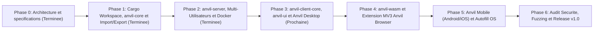

# Feuille de Route & Plan d'Exécution Incrémental — **Anvil**

> **Statut actuel** : **Phase 2 terminée (`anvil-server`, Multi-Utilisateurs & Docker) — Phase 3 à démarrer**  
> **Référence technique** : [`ARCHITECTURE.md`](./ARCHITECTURE.md)

---

## 1. Règles d'Exécution Incrémentale & Quality Gates

Chaque phase est développée, compilée et testée de bout en bout avant tout passage à la phase suivante. Aucune dette technique critique n'est reportée d'une phase à l'autre.

### Règles strictes de qualité Rust (appliquées dès la Phase 1)

1. **Zéro panique en code de production** : le `Cargo.toml` racine configure `[workspace.lints.clippy]` avec `unwrap_used = "deny"`, `expect_used = "deny"` et `panic = "deny"` (seuls les modules `#[cfg(test)]` et tests d'intégration peuvent utiliser des assertions explicites).
2. **Gestion d'erreurs typée** : `thiserror` dans les bibliothèques (`anvil-core`, `anvil-client-core`, `anvil-wasm`) et `anyhow` + types d'erreurs HTTP structurés dans `anvil-server`.
3. **Hygiène mémoire obligatoire** : tout buffer manipulant un mot de passe, une graine KDF, une `VaultKey` ou un secret TOTP implémente `Zeroize` / `ZeroizeOnDrop`.
4. **Quality Gate bloquante entre chaque phase** :

```bash
cargo fmt --all -- --check
cargo clippy --workspace --all-targets -- -D warnings
cargo test --workspace
```

*(Complétée par `cargo audit`, `cargo deny check`, les tests `wasm-pack` / Playwright / Docker selon le périmètre de la phase.)*

---

## 2. Vue d'Ensemble du Développement (Phase 0 → Phase 6)



---

## Phase 0 — Architecture, UI/UX & Spécifications *(Statut : Terminée)*

- **Objectifs** : Figer la direction visuelle, les choix de stack, les primitives cryptographiques Zero-Knowledge, le schéma SQL, le contrat REST et le plan de livraison avant l'initialisation du code.
- **Livrables** :
  - `docs/ARCHITECTURE.md`
  - `docs/ROADMAP.md`
- **Critère de passage** : Spécifications techniques figées et prêtes pour l'implémentation.

---

## Phase 1 — Cargo Workspace, `anvil-core` & Import/Export Multi-Gestionnaires

### Objectifs
Bâtir 100 % de la logique critique dans un cœur pur Rust compilable en natif (sans dépendance OS bloquante) et prêt pour la cible `wasm32-unknown-unknown`, incluant la cryptographie Zero-Knowledge, le TOTP, le générateur, la recherche floue et tous les parseurs d'import/export.

### Livrables concrets
- Initialisation monorepo : `Cargo.toml` (workspace + lints stricts), `rustfmt.toml`, `deny.toml`.
- `crates/anvil-core/` :
  - `crypto/` : dérivation `Argon2id` + `HKDF-SHA256`, chiffrement `XChaCha20-Poly1305` (enveloppe binaire `0x01`, AAD strict `user_id`/`item_id`/`folder_id`/`blob_id`), types protégés `ZeroizeOnDrop`, et déchiffreur `Bitwarden encType=2` (`PBKDF2`/`Argon2id` + `AES-256-CBC` + `HMAC-SHA256`).
  - `models/` : `VaultItem` (`login`, `secure_note`), `VaultFolder`, `VaultBlobMeta`, règles URI (`base_domain`, `host`, `starts_with`, `exact`, `regex`, `never`), `password_history`.
  - `totp.rs` : implémentation **RFC 6238** / **RFC 4226** (`SHA1`, `SHA256`, `SHA512`, `6`/`8` digits, période configurable) + parseur/générateur URI `otpauth://totp/...`.
  - `password.rs` : générateur CSPRNG (mots de passe aléatoires + passphrases liste de mots EFF) + jauge d'entropie (`zxcvbn`).
  - `search.rs` : recherche floue `nucleo-matcher` sur titre, URL, username, email, dossier + extraction `eTLD+1` via `psl`.
  - `media.rs` *(feature `media`)* : redimensionnement logo (`<= 128×128`), ré-encodage WebP/PNG et suppression complète des métadonnées EXIF.
  - `importers/` : Bitwarden JSON (non chiffré & chiffré par mot de passe), Bitwarden CSV, Chrome/Edge/Brave/Firefox CSV, KeePass/KeePassXC CSV & XML, 1Password CSV & `.1pux` (avec garde anti zip-bomb), Proton Pass & Dashlane (CSV générique avec mapping de colonnes), workflow *dry-run* (`ImportPreview`) et détection/résolution de doublons (`Skip` / `Merge` / `CreateNew`).
  - `exporters/` : archive native chiffrée `.anvil` (avec logos), export Bitwarden JSON compatible, export CSV standard.

### Critères de validation (*Definition of Done*)
- Quality Gate Rust (`cargo fmt`, `cargo clippy -- -D warnings`, `cargo test`) 100 % verte.
- Vérification de compilation croisée `cargo check -p anvil-core --target wasm32-unknown-unknown --no-default-features` réussie.
- Tests avec vecteurs officiels : **RFC 6238** (TOTP), vecteurs `Argon2id` / `XChaCha20-Poly1305`, tests `proptest` d'invariance roundtrip chiffrement/déchiffrement et rejet systématique si `user_id`, `item_id`, `blob_id` ou le tag est altéré.
- Jeux de fixtures réelles anonymisées validant chaque importeur (Bitwarden clair + chiffré, navigateurs, KeePass XML/CSV, 1Password `.1pux`/CSV, Proton/Dashlane).

### Risques & Points d'attention
- **Faux positifs de déduplication à l'import** : normalisation rigoureuse des URLs (`psl`) et casse des emails tout en offrant un aperçu *dry-run* clair avant écriture.
- **Zip-bombs sur `.1pux` / `.anvil`** : imposer des bornes strictes de taille décompressée et de nombre d'entrées.

---

## Phase 2 — Serveur Self-Hosted `anvil-server`, Multi-Utilisateurs & Docker

### Objectifs
Déployer le backend Zero-Knowledge haute performance capable d'héberger plusieurs utilisateurs strictement isolés sur **PostgreSQL** ou **SQLite**, administrable par CLI et prêt pour un déploiement Docker derrière Caddy, Traefik ou Nginx.

### Livrables concrets
- `crates/anvil-server/` :
  - Couche DB dual-backend : `DbPool { Postgres(PgPool), Sqlite(SqlitePool) }`, trait `VaultRepository`, migrations dédiées `migrations/postgres/` et `migrations/sqlite/` (avec `WAL` et `foreign_keys = ON`).
  - Authentification : `/prelogin` (faux sels déterministes anti-énumération), `/register` (contrôlé par `ANVIL_ALLOW_SIGNUPS=false` par défaut + jetons d'invitation hashés `SHA-256`), `/login` (re-hachage serveur `Argon2id` + `ANVIL_AUTH_PEPPER`), JWT `EdDSA` (15 min), rotation stricte des Refresh Tokens avec détection de replay (révocation famille) et gestion/révocation des sessions.
  - Endpoints coffre : `/vault/sync` différentiel par `revision` avec gestion optimiste des conflits (`409 Conflict`), CRUD items/dossiers, upload/download de blobs chiffrés (`<= 256 KiB`), rotation atomique du Master Password (`/account/rotate-password`), proxy favicon opt-in (`ANVIL_ENABLE_FAVICON_PROXY=false` par défaut) protégé contre SSRF.
  - Rate limiting anti brute-force via `tower_governor` avec support contrôlé de `ANVIL_TRUSTED_PROXIES`.
  - CLI `clap` embarquée : `serve`, `invite create/list/revoke`, `user list/disable/promote`, `migrate`.
- `deploy/` : `Dockerfile` multi-stage (`cargo-chef` + image finale minimale non-root), `docker-compose.yml`, `.env.example`, `Caddyfile.example`, `traefik.example.yml`.

### Critères de validation (*Definition of Done*)
- Quality Gate Rust (`fmt`, `clippy -D warnings`, `test`) passée sur `anvil-server` avec exécution de la suite de tests d'intégration sur **SQLite** et **PostgreSQL**.
- Tests de sécurité automatisés prouvant :
  1. **Isolation multi-utilisateurs** : l'utilisateur B ne peut ni lire, ni modifier, ni supprimer les fiches/dossiers/blobs/sessions de l'utilisateur A (`403`/`404`).
  2. **Contrôle des inscriptions** : `ANVIL_ALLOW_SIGNUPS=false` refuse toute inscription sans invitation valide.
  3. **Anti-replay Refresh Token** : réutiliser un refresh token déjà roté révoque toute la famille de sessions et retourne `401`.
  4. **Conflit de synchro** : un `base_revision` obsolète retourne `409 Conflict` sans écraser les données serveur.
- Build Docker fonctionnel (`docker build`) + test de démarrage `docker compose up` et vérification `/api/v1/health`.

### Risques & Points d'attention
- **Parité SQL PostgreSQL vs SQLite** : aucune requête SQL brute ad-hoc hors du module `db/{postgres,sqlite}` ; toute évolution de schéma est testée sur les deux moteurs en CI.
- **Usurpation d'IP derrière reverse proxy** : ne jamais faire confiance à `X-Forwarded-For` si `ANVIL_TRUSTED_PROXIES` n'est pas configuré.

---

## Phase 3 — `anvil-client-core`, Design System `packages/anvil-ui` & `Anvil Desktop` (Tauri v2)

### Objectifs
Livrer le socle client natif hors-ligne/synchro, le Design System « Forge Moderne / Acier Sombre » en Svelte 5 + Tailwind v4, et l'application **Anvil Desktop** (Windows prioritaire, macOS & Linux) avec sa barre de titre 100 % personnalisée.

### Livrables concrets
- `crates/anvil-client-core/` :
  - Cache local SQLite contenant exclusivement les enveloppes chiffrées + file de mutations hors-ligne.
  - Moteur de synchronisation différentielle et résolveur de conflits côté client (déchiffrement comparatif avant présentation de choix à l'utilisateur).
  - Gestionnaire de verrouillage en RAM (`Zeroizing`) + minuteur d'inactivité.
- `packages/anvil-ui/` :
  - Tokens CSS Forge Moderne (`tokens.css`), polices locales `Inter` & `JetBrains Mono` (zéro CDN), composants réactifs (liste virtuelle, panneau de détail, anneau compte à rebours TOTP `30s`, coloration syntaxique des mots de passe, assistant d'import *dry-run*, générateur, gestion des conflits, logos personnalisés avec fallback initiales stylisées).
- `apps/desktop/` (Tauri v2) :
  - Fenêtre frameless (`decorations: false`, `shadow: true`) + composant `CustomTitlebar.svelte` (`40px`, logo + statut sync à gauche, recherche `Ctrl+K` centrée, boutons `─`/`□`/`✕` `46×40` à droite, gestion maximisé/unfocused).
  - Module Win32 Rust (`apps/desktop/src-tauri/src/platform/windows.rs`) : `WM_NCHITTEST` (`HTMAXBUTTON` pour **Snap Layouts Windows 11**, bords `6px` pour redimensionnement natif) et `WTSRegisterSessionNotification` (verrouillage automatique dès `Win+L` ou veille).
  - Presse-papiers sécurisé (`arboard` + flags Win32 excluant l'historique `Win+V` et la synchro cloud) avec effacement conditionnel à `30s` vérifié par hash SHA-256.
  - Intégration OS : System Tray (verrouiller, ouvrir, quitter), instance unique, raccourci clavier global, biométrie locale (Windows Hello / Touch ID / Linux Secret Service) et upload de logos personnalisés (`media` feature + `PUT /vault/blobs`).

### Critères de validation (*Definition of Done*)
- Quality Gate Rust complète + typecheck/build frontend (`svelte-check`, `vite build`) + compilation Tauri Desktop réussie.
- Tests manuels et automatisés sous Windows 11 :
  - Aucune barre blanche native visible ; drag, double-clic maximisation, redimensionnement par les bords et **Snap Layouts Windows 11** fonctionnels.
  - Copie de mot de passe : absent de l'historique `Win+V` et effacé après 30s (sauf si l'utilisateur a copié autre chose entre-temps).
  - `Win+L` verrouille immédiatement le coffre et purge les secrets de la RAM.
  - Import d'un export Bitwarden JSON réel (clair et chiffré) + aperçu *dry-run* + vérification TOTP en temps réel.

### Risques & Points d'attention
- **Collisions drag-region vs inputs** : garder la barre de recherche et tous les boutons strictement hors de `data-tauri-drag-region`.
- **Fuite de secrets dans le WebView** : ne jamais stocker la `VaultKey` ni le Master Password dans `localStorage`, `sessionStorage` ou un store Svelte persistant.

---

## Phase 4 — `anvil-wasm` & Extension Navigateur `Anvil Browser` (Manifest V3)

### Objectifs
Exposer `anvil-core` en WebAssembly pour l'extension navigateur Manifest V3 (Chrome, Edge, Brave, Firefox) garantissant une identité cryptographique bit-à-bit avec les clients natifs et une protection anti-phishing stricte.

### Livrables concrets
- `crates/anvil-wasm/` :
  - Bindings `wasm-bindgen` + génération TypeScript `tsify-next` (KDF, chiffrement/déchiffrement, TOTP, générateur, recherche floue, matching domaine `eTLD+1`, import/export).
  - Gestion de session coffre en mémoire linéaire WASM avec commande explicite `lock()` déclenchant `zeroize`.
- `apps/extension/` :
  - Manifests MV3 pour Chromium (Chrome/Edge/Brave) et Firefox.
  - Service Worker background gérant le coffre WASM en RAM volatile, la synchronisation avec l'URL self-hosted Anvil et l'auto-verrouillage par `chrome.alarms`.
  - Content Script avec **Shadow DOM fermé (`mode: 'closed'`)** injectant le bouton inline Anvil sur les champs `username`, `email`, `password` et `OTP` sans collision CSS avec le site hôte.
  - Module anti-phishing (`security/`) : vérification stricte via `psl` (`eTLD+1`), blocage automatique de l'autofill dans les `<iframe>` cross-origin non approuvées, avertissement sur connexions HTTP non sécurisées.
  - Détection de nouvelles soumissions de formulaires ou changements de mot de passe pour proposer la sauvegarde/mise à jour dans le coffre.
  - Popup Svelte 5 rapide partageant `packages/anvil-ui`.

### Critères de validation (*Definition of Done*)
- Quality Gate Rust + build `wasm-pack` propre sans avertissement.
- **Tests de parité cryptographique Natif ↔ WASM** : une fiche chiffrée par `anvil-core` (natif) est déchiffrée avec succès par `anvil-wasm` (et inversement) avec validation stricte des AAD.
- Tests unitaires anti-phishing couvrant sous-domaines trompeurs, `eTLD+1` multi-niveaux (`.co.uk`, `.github.io`), homographes IDN (Punycode) et iframes cross-origin.
- Chargement et tests fonctionnels de l'extension packagée sur Chromium (Chrome/Edge/Brave) et Firefox.

### Risques & Points d'attention
- **Cycle de vie éphémère du Service Worker MV3** : Chromium suspend le worker après ~30s d'inactivité ; gérer proprement soit le verrouillage par sécurité, soit un mécanisme de session éphémère en mémoire protégée (`chrome.storage.session` chiffré par une clé volatile en RAM si l'utilisateur autorise un délai d'inactivité court), documenté clairement.
- **Isolation DOM** : les scripts de la page ne doivent jamais pouvoir lire le contenu du Shadow DOM d'Anvil ni intercepter le presse-papiers.

---

## Phase 5 — Application Mobile `Anvil Mobile` (Tauri v2 — Android & iOS)

### Objectifs
Porter Anvil sur Android et iOS via Tauri v2 en réutilisant `anvil-client-core` et `packages/anvil-ui`, avec scanner de QR code natif, biométrie matérielle et préparation/intégration de l'auto-complétion système.

### Livrables concrets
- `apps/mobile/` :
  - UI mobile adaptative tactile (navigation par onglets bas, gestes rapides, anneau TOTP grand format).
  - Onboarding par saisie d'URL serveur ou **scan de QR code de configuration** (contenant URL serveur + éventuel email/token d'invitation).
  - Scanner QR code natif (caméra) pour ajout instantané de comptes `otpauth://totp/...`.
  - Déverrouillage biométrique local (`tauri-plugin-biometric`) protégeant la `VaultKey` dans **Android Keystore** et **iOS Secure Enclave**.
  - Intégration & ponts natifs pour l'auto-complétion OS :
    - **Android** : module Kotlin `AutofillService` (`android-autofill/`) interrogeant le coffre chiffré local via JNI/UniFFI ou pont IPC sécurisé.
    - **iOS** : cible App Extension Swift `ASCredentialProviderViewController` (`ios-autofill/`) avec partage sécurisé via App Group Keychain.

### Critères de validation (*Definition of Done*)
- Quality Gate Rust + compilation Android (`cargo tauri android build` / APK debug) validée en environnement CI/local SDK Android.
- Compilation iOS (`cargo tauri ios build`) vérifiée sur runner macOS/Xcode (ou validation du projet Xcode généré).
- Tests fonctionnels : scan QR code `otpauth://` → génération code 6 chiffres exact, déverrouillage biométrique, synchronisation bidirectionnelle avec `anvil-server`.

### Risques & Points d'attention
- **Isolation des App Extensions Android/iOS** : sur iOS notamment, l'extension `AutoFill Credential Provider` s'exécute dans un processus séparé à mémoire limitée (~30–50 Mo) ; prévoir un profil mémoire léger (`Argon2id` ou déverrouillage via `VaultKey` déjà stockée dans l'enclave App Group protégée par Face ID).

---

## Phase 6 — Audit, Durcissement Sécurité & Release v1.0

### Objectifs
Soumettre l'ensemble de la chaîne cryptographique, réseau et client à un audit systématique, automatiser les tests de robustesse (fuzzing) et publier une v1.0 prête pour la production auto-hébergée.

### Livrables concrets
- **Campagne de Fuzzing (`cargo-fuzz`)** : cibles sur le décodeur d'enveloppes binaires AEAD, le parseur `otpauth://` et les parseurs d'import (Bitwarden JSON, XML KeePass, `.1pux`).
- **Tests adversariaux automatisés** : tentatives de substitution AAD inter-utilisateurs/inter-fiches, attaque par rejeu de Refresh Token, injection SQL/XSS/SSRF sur `anvil-server`, vérification de l'absence de secrets dans les logs et core dumps (`RLIMIT_CORE=0` sous Unix).
- **Mécanisme de rotation d'urgence de `VaultKey`** : workflow permettant à l'utilisateur de régénérer une nouvelle `VaultKey` et re-chiffrer l'ensemble des fiches/blobs en transaction si un appareil compromis a fuité une ancienne clé biométrique.
- **Durcissement Docker & CI/CD** :
  - `docker-compose.yml` durci (`read_only: true`, `cap_drop: [ALL]`, `no-new-privileges: true`, tmpfs minimal, utilisateur non-root `65532:65532`).
  - Pipeline GitHub Actions complet : `fmt`, `clippy -D warnings`, `test`, `wasm32`, `cargo audit`, `cargo deny check`, génération SBOM et signatures d'artefacts.
- Documentation finale : `docs/SECURITY.md` (modèle de menaces, garanties Zero-Knowledge, limites connues) et `docs/SELF_HOSTING.md` (reverse proxies TLS, sauvegardes SQLite/PostgreSQL, mises à jour).

### Critères de validation (*Definition of Done*)
- Zéro vulnérabilité critique/haute remontée par `cargo audit` et `cargo deny`.
- Campagne `cargo-fuzz` exécutée sans crash ni panique sur l'ensemble des parseurs.
- Toutes les Quality Gates vertes sur l'intégralité du monorepo (Rust, WASM, Desktop, Extension, Mobile, Docker).
- Tag `v1.0.0` prêt pour publication.
